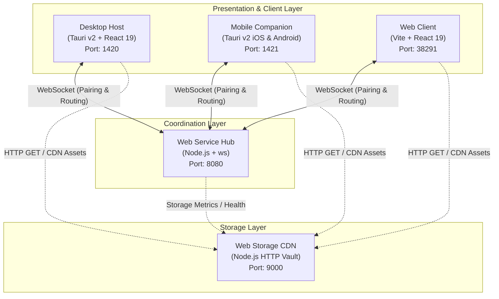
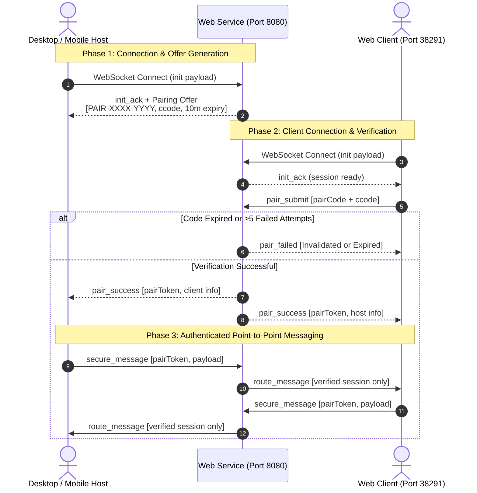

# OMNI FOUNDATION ARCHITECTURE SPECIFICATION

Version: 1.1.0  
Status: Active  

---

## 1. System Overview

Omni Foundation is a multi-platform runtime and communication suite designed for low-latency peer-to-peer data coordination, static asset delivery, cross-device authentication, and multi-agent virtual office orchestration.

### 1.1 Workspace Monorepo Topology



---

## 2. Package Boundaries and Responsibilities

### 2.1 Desktop Platform (`desktop-platform`)
- **Technology**: Tauri 2.12+, React 19, TypeScript, Vite 8, Rust 1.98+.
- **Role**: Primary desktop workstation host.
- **Port**: 1420 (Vite frontend dev server).
- **Key Responsibilities**:
  - Generates pairing offers conforming to `PAIR-XXXX-YYYY`.
  - Displays challenge codes (`ccode`), unique slugs, and connection status.
  - Native Rust IPC commands (`greet`, `get_storage_stats` via `statvfs` / `GetDiskFreeSpaceExW`).
  - PS5-themed UI with ambient particle canvas and audio feedback.
  - Centralized configuration: `src/config/env.ts`.

### 2.2 Mobile Platform (`mobile-platform`)
- **Technology**: Tauri 2.12+, React 19, TypeScript, Vite 8, Rust 1.98+ (iOS and Android targets).
- **Role**: Handheld mobile companion.
- **Port**: 1421 (Vite mobile dev server).
- **Key Responsibilities**:
  - Mobile viewport optimization with safe-area insets (`env(safe-area-inset-*)`).
  - 8-digit segmented OTP PIN input for pairing submission.
  - Native Rust IPC commands (`get_mobile_device_info`, `get_storage_stats`, `greet`).
  - Dynamic host resolution (`getEffectiveStorageBase`) for LAN Wi-Fi connectivity.
  - Centralized configuration: `src/config/env.ts`.

### 2.3 Web Platform (`web-platform`)
- **Technology**: React 19, TypeScript, Vite 8.
- **Role**: Remote browser client interface.
- **Port**: 38291 (Vite browser dev server).
- **Key Responsibilities**:
  - Connects to centralized WebSocket hub.
  - Submits pairing verification requests with pairing code and challenge code.
  - Exchanges authenticated messages with paired desktop or mobile hosts.
  - Centralized configuration: `src/config/env.ts`.

### 2.4 Web Service (`web-service`)
- **Technology**: Node.js 24+, TypeScript 5+, `ws` 8+.
- **Port**: 8080 (HTTP health & WebSocket server).
- **Key Responsibilities**:
  - Cryptographic credential generation (256-bit session tokens, random uppercase pairing codes).
  - 10-minute pairing expiration (`PAIR_CODE_EXPIRY_MS`).
  - IP-based brute-force protection (maximum 5 failed attempts per code, 10 attempts per minute per IP).
  - Dynamic origin allowlist for local private subnets (`192.168.*`, `10.*`, `172.16-31.*`, `.local`) in development mode.
  - Strict point-to-point message routing via verified `pairToken`.
  - Centralized configuration: `src/config.ts`.

### 2.5 Web Storage (`web-storage`)
- **Technology**: Node.js 24+, TypeScript 5+, `mime-types`.
- **Port**: 9000 (HTTP CDN server).
- **Key Responsibilities**:
  - Static media delivery via `GET /cdn/:filename` with caching and MIME detection.
  - Mutation endpoints (`POST /cdn/upload`, `DELETE /cdn/:filename`) protected by constant-time `STORAGE_API_KEY` verification.
  - Path traversal containment check using `path.relative` within `STORAGE_PATH`.
  - File extension whitelist validation configured via `ALLOWED_EXTENSIONS`.
  - Storage directory management (`CDN_FOLDER`, default `cdn-global`).
  - Centralized configuration: `src/config.ts`.

---

## 3. Communication and Security Flow

### 3.1 Handshake and Pairing Sequence



---

## 4. Web Storage Security Architecture

```mermaid
flowchart TD
    Req["Incoming HTTP Request<br/>(GET / POST / DELETE)"] --> Route{"Method & Path"}

    Route -->|"GET /cdn/:filename"| PathCheck["Path Containment Check<br/>path.relative inside STORAGE_PATH"]
    PathCheck -->|Traversal Detected| E400["400 Bad Request"]
    PathCheck -->|Valid Path| FileExists{"File Exists?"}
    FileExists -->|No| E404["404 Not Found"]
    FileExists -->|Yes| Stream["Stream File with<br/>MIME & Cache-Control"]

    Route -->|"POST /cdn/upload"| AuthCheck{"Check API Key<br/>(X-API-Key / Bearer)"}
    AuthCheck -->|Unauthorized| E401["401 Unauthorized"]
    AuthCheck -->|Valid| SizeCheck{"Payload Size <= 50MB?"}
    SizeCheck -->|Exceeded| E413["413 Payload Too Large"]
    SizeCheck -->|Valid| ExtCheck{"Extension in Whitelist?<br/>ALLOWED_EXTENSIONS"}
    ExtCheck -->|Blocked (.exe, .sh, etc.)| E415["415 Unsupported Media Type"]
    ExtCheck -->|Allowed (png, mp3, pdf, etc.)| Save["Save to CDN Folder<br/>Return 201 Created"]

    Route -->|"DELETE /cdn/:filename"| DelAuth{"Check API Key"}
    DelAuth -->|Valid| DelFile["Remove File<br/>Return 200 OK"]
```

---

## 5. Root Workspace Orchestration

The root `package.json` provides unified scripts to build, test, and run all 5 packages:

| Command | Action | Scope |
|---|---|---|
| `npm run dev:desktop` | Runs Vite frontend server (port 1420) | `desktop-platform` |
| `npm run dev:desktop:tauri` | Runs full Tauri v2 desktop application | `desktop-platform` |
| `npm run dev:web` | Runs Vite remote browser client (port 38291) | `web-platform` |
| `npm run dev:mobile` | Runs Vite mobile viewport server (port 1421) | `mobile-platform` |
| `npm run dev:mobile:tauri` | Runs full Tauri v2 mobile application | `mobile-platform` |
| `npm run dev:service` | Runs live-reloading WebSocket server (port 8080) | `web-service` |
| `npm run dev:storage` | Runs live-reloading HTTP CDN server (port 9000) | `web-storage` |
| `npm run build:all` | Compiles TypeScript and builds production bundles | All 5 packages |
| `npm run test:all` | Runs 23 unit tests across backend, Rust, and storage | All 5 packages |
| `npm run check:all` | Runs typechecks and `cargo check` across platforms | All 5 packages |

---

## 6. AI Office Skills and Governance

The workspace incorporates a modular suite of 18 AI Office skills located in `.gemini/skills/` and `.agents/skills/`:

```mermaid
graph LR
    subgraph Governance["Governance & Rules"]
        R["ai-office-governance.md"]
    end

    subgraph Executive["Leadership & Strategy"]
        S1["ai-office-architect"]
        S2["agent-hierarchy-management"]
        S3["agent-identity-management"]
    end

    subgraph Coordination["Coordination & Communication"]
        S4["multi-agent-orchestration"]
        S5["agent-to-agent-communication"]
        S6["agent-meeting-management"]
        S7["agent-task-delegation"]
    end

    subgraph Execution["Execution & Tooling"]
        S8["agent-autonomous-workflow"]
        S9["agent-tool-integration"]
        S10["local-first-desktop-architecture"]
        S11["virtual-office-design"]
        S12["agent-visualization"]
    end

    subgraph Quality["Quality & Operations"]
        S13["agent-quality-assurance"]
        S14["agent-performance-monitoring"]
        S15["agent-permission-security"]
        S16["agent-cost-management"]
        S17["agent-memory-management"]
        S18["agent-skill-management"]
    end

    Governance --> Executive
    Executive --> Coordination
    Coordination --> Execution
    Execution --> Quality
```



---

## 7. Security Protections Summary

1. **Exact-Match Pairing**: Pairing codes are verified strictly by exact value. Partial or prefix matching is rejected.
2. **Brute Force Invalidation**: A pairing code is automatically destroyed after 5 failed challenge attempts.
3. **IP Rate Limiting**: 10 pairing attempts per minute per IP address.
4. **Pre-Buffering Frame Limit**: WebSocket server rejects frames over 1MB at the socket layer before JSON parsing.
5. **Path Traversal Guard**: All file accesses use strict `path.relative` containment checks inside `STORAGE_PATH`.
6. **File Extension Whitelist**: Uploads are restricted to extensions defined in `ALLOWED_EXTENSIONS`.
7. **Timing-Safe Key Comparison**: Storage API keys are validated using `crypto.timingSafeEqual`.
8. **Anti-Slop Compliance**: Strict adherence to Rule R-02 (zero em dashes in code, comments, documentation, and UI).
